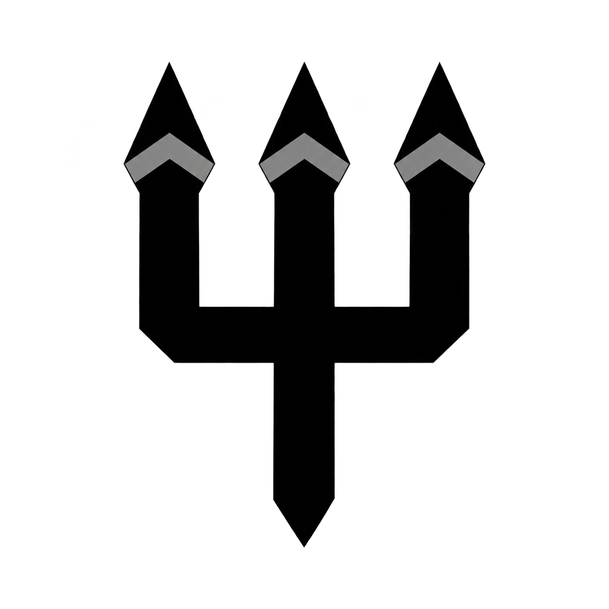

# Trident

<p align="center">
  
</p>

A three-way hybrid KEM combining **X25519**, **ML-KEM-768** (FIPS 203) and **HQC-192** (FIPS 207). It follows the X-Wing design and adds a third leg.

## Why three?

X-Wing hedges between classical security (X25519) and post-quantum security (ML-KEM). Trident adds a second post-quantum assumption from a different family:

| Component  | Assumption                             | Breaks if...                                         |
|------------|----------------------------------------|------------------------------------------------------|
| X25519     | Elliptic-curve discrete log            | A cryptographically relevant quantum computer exists |
| ML-KEM-768 | Module-LWE (lattices)                  | Lattice cryptanalysis improves enough                |
| HQC-192    | Quasi-cyclic syndrome decoding (codes) | Code-based cryptanalysis improves enough             |

The shared key stays secure as long as **any one** of the three components is IND-CCA2 secure. This holds against both classical and quantum adversaries when the surviving component is ML-KEM or HQC. The target scenario is a partial lattice break (say a 20-bit loss) that leaves ML-KEM "probably fine" but less comfortable to bet on for the long term. With Trident you do not have to choose between lattices and codes.

## Construction

All sizes are in bytes. `||` is concatenation. `LABEL = "Trident-v1"` (ASCII, 10 bytes).

### Key generation

The decapsulation key is a 32-byte uniformly random `seed`.

```text
expanded = SHAKE256(LABEL || seed, 128)
seed_M   = expanded[0:64]   -> (dk_M, pk_M) = ML-KEM-768.KeyGen_internal(d = seed_M[0:32], z = seed_M[32:64])
sk_X     = expanded[64:96]  -> pk_X = X25519(sk_X, 9)
seed_H   = expanded[96:128] -> (pk_H, dk_H) = HQC-192.KeyGen(seed_kem = seed_H)

ek = pk_M (1184) || pk_X (32) || pk_H (4514)   = 5730 bytes
dk = seed                                       =   32 bytes
```

Unlike X-Wing, the seed expansion is domain-separated with `LABEL`. The same 32-byte seed used in X-Wing and in Trident therefore produces unrelated keys.

### Encapsulation

The encapsulation draws 104 random bytes, `m_M (32) || ek_X (32) || m_H (24) || salt_H (16)`:

```text
(ct_M, ss_M) = ML-KEM-768.Encaps_internal(pk_M, m_M)
ct_X         = X25519(ek_X, 9)
ss_X         = X25519(ek_X, pk_X)
(ct_H, ss_H) = HQC-192.Encaps(pk_H; m_H, salt_H)

ct = ct_M (1088) || ct_X (32) || ct_H (8978)   = 10098 bytes
ss = Combiner(ss_M, ss_X, ss_H, ct_X, pk_X, ct_H, pk_H)
```

### Decapsulation

```text
ss_M = ML-KEM-768.Decaps(dk_M, ct_M)
ss_X = X25519(sk_X, ct_X)
ss_H = HQC-192.Decaps(dk_H, ct_H)
ss   = Combiner(ss_M, ss_X, ss_H, ct_X, pk_X, ct_H, pk_H)
```

Decapsulation never fails. Both post-quantum components use implicit rejection. An all-zero (non-contributory) X25519 output is accepted, matching X-Wing's default behaviour.

### Encapsulation key validation

`EncapsulationKey::from_bytes` rejects:

* an ML-KEM-768 key that fails the FIPS 203 modulus check, and
* an HQC-192 key that is not canonically encoded. `s` packs `n = 35851` bits into 4482 bytes, so the top 5 bits of `pk_H`'s last byte must be zero.

As a result, every valid key has exactly one byte encoding.

### Combiner

```text
Combiner = SHA3-256(ss_M || ss_X || ss_H || ct_X || pk_X || ct_H || pk_H || LABEL)
```

Every input has a fixed length, so the concatenation is unambiguous.

* **ML-KEM** (`ct_M`, `pk_M` omitted): this is the same argument as X-Wing. ML-KEM's FO transform hashes `H(pk_M)` into `ss_M`, and its re-encryption check makes it ciphertext second-preimage resistant. Both properties come from SHA3, not from the lattice assumption. A drop in lattice security therefore does not weaken this binding.
* **X25519** (`ct_X`, `pk_X` included): this is the same argument as X-Wing.
* **HQC** (`ct_H`, `pk_H` included): FIPS 207's FO variant has the same structure as ML-KEM, so it probably binds its ciphertext as well. However, the binding analysis that X-Wing relies on has not been done for HQC. Hashing `ct_H` and `pk_H` in full means the combiner only requires HQC to be IND-CCA2. That matters in the scenario where HQC is the last component standing. The cost is roughly 13.5 KB of extra SHA3 input, which is small next to HQC itself.

## Sizes and performance

|                   | Trident | X-Wing |
|-------------------|--------:|-------:|
| Encapsulation key |  5730 B | 1216 B |
| Decapsulation key |    32 B |   32 B |
| Ciphertext        | 10098 B | 1120 B |
| Shared key        |    32 B |   32 B |

HQC accounts for most of the size and time. The decapsulation key caches its expanded component keys, so `decapsulate` does not rerun key generation. Run `cargo bench` to measure on your machine.

## Usage

```rust,ignore
// features = ["getrandom"]
let (dk, ek) = trident::generate_key_pair();
let (ct, ss_sender) = ek.encapsulate();
let ss_receiver = dk.decapsulate(&ct);
assert_eq!(ss_sender, ss_receiver);

// Wire formats
let ek_bytes: [u8; trident::ENCAPSULATION_KEY_SIZE] = ek.to_bytes();
let ct_bytes: [u8; trident::CIPHERTEXT_SIZE] = ct.to_bytes();
let dk_bytes: &[u8; 32] = dk.as_bytes();
```

Any `rand_core` 0.10 `CryptoRng` also works through `generate_key_pair_from_rng` and `encapsulate_with_rng`. With the `hazmat` feature, `encapsulate_deterministic` takes explicit randomness for producing test vectors.

The crate is `no_std` and does not allocate.

## Status / caveats

* **This is an experimental construction.** It is not standardized, and its security has not been formally analyzed beyond the reasoning above.
* No external test vectors exist. The tests check the implementation against a hand-built recomputation from the upstream `ml-kem`, `hqc-kem` and `x25519-dalek` crates. They also pin regression vectors, including edge-case inputs and a non-contributory X25519 ciphertext.
* `hqc-kem` is a release candidate (`0.1.0-rc.0`) and is pinned exactly.
* Trident's own code does no secret-dependent branching or indexing. Its side-channel resistance is bounded by that of the three component crates, and none of them has had an independent audit.
* Secret state that Trident owns (the seed, the component secret keys, and the hash/XOF state) is wiped on drop. As with RustCrypto generally, compiler-generated copies of stack temporaries are not guaranteed to be wiped.
* The RustCrypto `kem` traits are not implemented. They need `hybrid-array` type-level sizes for 5730 and 10098, which do not exist upstream.

## License

Licensed under either of [Apache License, Version 2.0](LICENSE-APACHE) or [MIT license](LICENSE-MIT), at your option.
